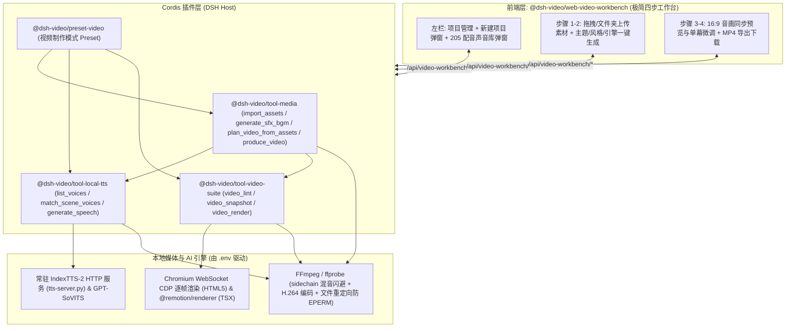

# 🎬 DSH Video Workbench (`dsh-video-workbench`)

> **面向 DeepSeek Harness (DSH) 的双引擎（HTML5/Canvas 动效 & Remotion）AI 全链路视频工作台插件套件**  
> **Dual-Engine (HTML5 & Remotion) Multimodal AI Video Production Studio for DeepSeek Harness — Import Assets, Generate Copy, SFX, VFX, Motion, BGM & Real Local Voiceover**

[](./LICENSE)
[](#)
[](#)
[](#)

---

## 📖 目录 / Table of Contents
- [一、核心特性 (Features)](#-一核心特性-features)
- [二、系统架构图 (Architecture)](#-二系统架构图-architecture)
- [三、新手快速上手：导入素材并一键生成完整视频](#-三新手快速上手导入素材并一键生成完整视频)
- [四、Windows 11 安装与启动指南 (Quick Start)](#-四windows-11-安装与启动指南-quick-start)
- [五、本地 TTS 与自定义音色包指南](#-五本地-tts-与自定义音色包指南)
- [六、通过 GitHub Desktop 发布与更新](#-六通过-github-desktop-发布与更新)
- [七、English Documentation](#-七english-documentation)

---

## ✨ 一、核心特性 (Features)

1. **用户素材导入与智能目录扫描 (`@dsh-video/tool-media`)**：
   - 工作台左栏支持 **📂 选择本地文件夹**、**📎 选择多素材文件上传** 以及 **绝对路径批量扫描导入**（图片 `.png/.jpg/.webp`、视频 `.mp4/.mov/.webm`、背景音乐/音效 `.wav/.mp3/.flac` 与文本文档 `.txt/.md`）。
   - 自动调用 `ffprobe` 检测图片分辨率与视频/音频精确时长，并生成缩略图供前端实时预览。
2. **AI 导演一站式成片策划 (`plan_video_from_assets` / `produce_video`)**：
   - 结合用户主题、风格（`科技产品风` / `电影感宣传片` / `人文纪录片` / `高燃短视频` / `温暖治愈风`）与导入素材，自动编排多幕分镜脚本、旁白文案、视觉排版、Ken Burns 推拉摇移运镜、转场特效、粒子/扫光视觉特效 (VFX)、转场音效 (SFX)、BGM 配乐策略与同步字幕。
   - 同时自动生成可运行、可二次精修的 **HTML5/Canvas** (`index.html`) 与 **Remotion 4.x TSX** (`src/Root.tsx` + `src/VideoComposition.tsx`) 双引擎工程源码。
3. **音效与配乐合成 + 自动闪避多轨混音 (`generate_sfx_bgm`)**：
   - 支持用户自定义导入 BGM/SFX，也内置 48kHz 立体声无损 WAV 合成器（`whoosh`/`impact`/`pop`/`chime`/`riser` 音效 + 多种曲风和弦配乐）。
   - 渲染阶段自动调用 `ffmpeg` `sidechaincompress` 侧链闪避混音：人声旁白出现时 BGM 自动压低让位、停顿期平滑回升，并叠加分镜音效输出 `master-audio.wav`。
4. **常驻本机 IndexTTS-2 真人配音 + 205 个音色包 (`@dsh-video/tool-local-tts`)**：
   - 通过 `scripts/tts-server.py` 将 6GB `IndexTTS-2` 模型常驻内存一次加载，逐句生成真实人声 WAV（支持情感参考与 GPT-SoVITS 切换），并严格通过 `ffprobe` 实测时长回填帧数（`durationInFrames = Math.ceil(durationSec * fps)`）。
5. **真·逐帧双引擎高清视频渲染 (`@dsh-video/tool-video-suite`)**：
   - **HTML5 引擎**：无头 Chromium 经 WebSocket CDP 逐帧驱动 `window.__seekToFrame(frame)` 与 `<video>` 帧同步抓取全部帧序列，结合 `master-audio.wav` 编码输出 H.264 (`yuv420p`) MP4。
   - **Remotion 引擎**：直接复用本地 `@remotion/bundler` 与 `@remotion/renderer` 逐帧渲染 React/TSX 组件序列与 `<Audio>`，同步生成 `snapshot-3x3.png` 九宫格视觉自检图。
6. **极简四步引导式工作台 UI + 开源零硬编码**：
   - **左栏（项目与声音库）**：新建/切换/删除视频项目、打开可搜索试听的 `205 款配音声音库` 弹窗并支持浏览器上传个人声音参考。
   - **主区域（顶栏四步向导）**：`1. 上传素材`（支持拖拽/文件/文件夹/本地目录与图片视频音频画廊）→ `2. 创作设置`（主题描述 + 5 套画面风格 + 双引擎 + 一键成片）→ `3. 预览微调`（16:9 同步舞台 + 底部可点击分镜条 + 右侧聚焦编辑单幕文案/配音/素材）→ `4. 导出 MP4`（内置成片播放器、下载按钮与折叠高级体检工具）。
   - **零硬编码路径与密钥**：所有本地路径统一由 `.env` 管理，附带脱敏 [`.env.example`](./.env.example)。

---

## 🏗️ 二、系统架构图 (Architecture)



---

## 🎯 三、新手快速上手：四步完成一条完整视频

1. 启动服务：在终端运行 `.\pnpm.cmd dsh video --keep-alive`，浏览器访问 `http://127.0.0.1:4399`（或在已挂载本插件的 DeepSeek Harness 桌面端打开视频工作台）。
2. **第 1 步 · 上传素材（可选）**：
   - 点击左上角 **「+ 新建视频项目」** 创建项目后，直接将图片、视频片段、背景音乐 (`bgm`)、音效 (`sfx`) 或文稿 (`.txt`/`.md`) 拖入上传区，或点击「选择文件 / 选择整个文件夹」（大体积目录也可展开「通过本机文件夹路径导入」）。
   - 没有现成素材也可以直接点击右上角 **「跳过素材，下一步」**。
3. **第 2 步 · 创作设置与一键成片**：
   - 填写视频主题（也可一键套用示例模板），选择 5 种视觉风格与目标引擎（推荐 `HTML5 极速动效` 或 `Remotion 电影精修`），挑选主配音或保持 `AI 自动匹配`。
   - 点击 **「一键生成完整视频」**，系统将自动完成：素材分析 → 文案与分镜规划 → `IndexTTS-2` 真人配音与 `ffprobe` 测长 → SFX 音效与闪避 BGM 混音 → 逐帧导出高清 MP4，完成后自动进入第 4 步播放与下载。
4. **第 3 步 · 预览与逐幕微调（可选）**：
   - 若想先改剧本再渲染，可在第 2 步点击 **「先生成分镜剧本与预览」** 进入第 3 步：下方点击任意一幕分镜卡片，画面立即跳转并可在右侧修改文案、更换单幕配音音色/情绪、重新生成配音并试听。
   - 调整满意后点右上角 **「导出 MP4」** 进入第 4 步播放、下载成品或展开折叠「高级检查工具」查看 `3×3 九宫格预览图` 与规范体检报告。

---

## 🚀 四、Windows 11 安装与启动指南 (Quick Start)

### 1. 复制并配置环境变量 `.env`

```powershell
cd dsh-video-workbench
Copy-Item .env.example .env
```

编辑 `.env` 文件，填入你本机的 `DSH_APP_ROOT`、`FFMPEG_PATH`、`FFPROBE_PATH`、`INDEXTTS_ROOT`、`REMOTION_TEMPLATE_ROOT` 等路径（`.env` 已被 `.gitignore` 忽略，不会上传至 GitHub）。

### 2. 常用命令

```powershell
# 挂载本地 Cordis profile 与软链接，并运行基础服务冒烟检查
.\pnpm.cmd dsh video

# 启动常驻 Web 工作台服务 (http://127.0.0.1:4399)
.\pnpm.cmd dsh video --keep-alive

# 运行完整端到端自检（素材导入 + AI 策划 + 真人 IndexTTS-2 配音 + 多轨混音 + HTML5 & Remotion 双引擎渲染 + 开源脱敏扫描）
.\pnpm.cmd test
```

---

## 🎙️ 五、本地 TTS 与自定义音色包指南

- **导入音色包**：点击左下角 **「配音声音库 (205 款)」** 打开声音库弹窗，点击右上角 **「+ 上传我的声音」** 即可直接从电脑选取 `.wav` / `.mp3` 上传，支持即时原声「试听」与一键选用（底层同时支持 `.pt` 特征文件与目录批量导入）。
- **AI 智能匹配 vs 手动锁定**：全局或任意单幕分镜均支持设为 `AI 自动匹配最佳声音`，系统会自动结合分镜台词情绪、受众与角色标签挑选声线；也可在声音库里筛选试听后精准指定。

---

## 📦 六、通过 GitHub Desktop 发布与更新

1. 打开 **GitHub Desktop**，点击 **File → Add local repository...** 选择本地 `dsh-video-workbench` 目录。
2. `.env`、`node_modules/`、`output/`、`assets/`、`uploads/`、`*.mp4`、`*.wav` 等运行产物均已由 `.gitignore` 自动过滤，无需担心泄露隐私或占用仓库体积。
3. 填写提交信息并点击 **Commit to main**，再点击顶部 **Push origin** 即可同步更新到 GitHub。

---

## 🌐 七、English Documentation

### Overview
**DSH Video Workbench (`dsh-video-workbench`)** is an open-source, modular Cordis plugin suite for **DeepSeek Harness (DSH)** on Windows 11. It lets users import local images, video clips, background music, sound effects, and text notes, then uses an AI director to produce complete **HTML5/Canvas** and **Remotion 4.x** videos with narration copy, real local speech synthesis (**IndexTTS-2** / **GPT-SoVITS**), procedural/user SFX & sidechain-ducked BGM mixing, visual motion effects, synced subtitles, 3×3 visual QA sheets, and full-FPS H.264 MP4 rendering.

### Package Structure
- `packages/shared`: Zero-hardcode `.env` loader, file-redirected `ffmpeg`/`ffprobe` runner (prevents Windows sandbox `EPERM`), and `script.json` utilities.
- `packages/dsh-tool-media`: Asset importer (`import_assets`, `list_assets`), procedural 48kHz WAV SFX/BGM synthesizer & FFmpeg sidechain-ducking mixer (`generate_sfx_bgm`), AI storyboard director (`plan_video_from_assets`), dual-engine HTML5/Canvas + Remotion TSX code generators, and one-click production (`produce_video`).
- `packages/dsh-tool-local-tts`: Persistent `IndexTTS-2` HTTP server manager (`tts-server.py`), 205+ voice catalog (`list_voices`, `import_voice_pack`, `match_scene_voices`), and exact `ffprobe` duration backfill (`generate_speech`).
- `packages/dsh-tool-video-suite`: `video_lint`, `video_snapshot` (3×3 contact sheet), and full-FPS Chromium WebSocket CDP / `@remotion/renderer` MP4 exporter (`video_render`).
- `packages/dsh-preset-video`: Registers the `视频制作模式` (`video-maker`) Agent Preset with Windows 11 safeguards (`.npmrc` local cache + `Microsoft YaHei` / `Consolas` fonts).
- `packages/dsh-web-video-workbench`: Registers `/api/video-workbench/*` endpoints (including Byte-Range streaming, drag/folder/voice upload, and safe project deletion) and the minimalist 4-step Video Studio UI.

### License
Released under the [MIT License](./LICENSE).
