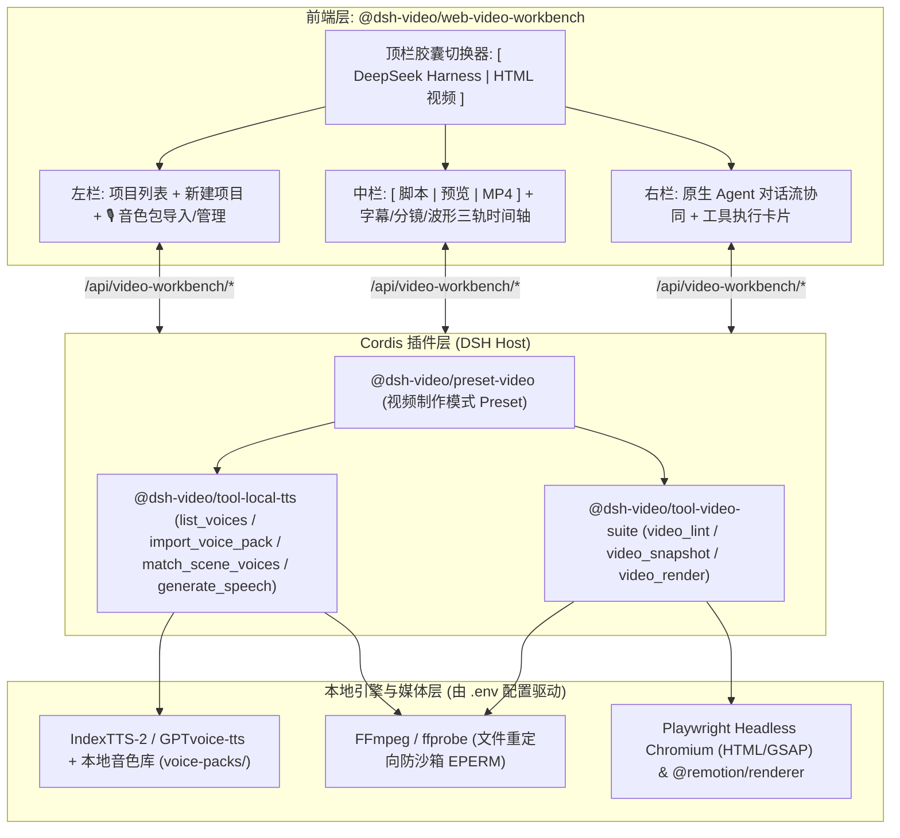

# 🎬 DSH Video Workbench (`dsh-video-workbench`)

> **面向 DeepSeek Harness (DSH) 的双引擎（HTML/GSAP & Remotion）多模态视频工作台插件套件**  
> **Dual-Engine (HTML/GSAP & Remotion) Video Workbench + Custom Voice Pack & AI Voice Matching for DeepSeek Harness**

[](./LICENSE)
[](#)
[](#)
[](#)

---

## 📖 目录 / Table of Contents
- [一、核心特性 (Features)](#-一核心特性-features)
- [二、系统架构图 (Architecture)](#-二系统架构图-architecture)
- [三、开源复用说明 (Open-Source Ecosystem & Reuse)](#-三开源复用说明-open-source-ecosystem--reuse)
- [四、Windows 11 安装与启动指南 (Quick Start)](#-四windows-11-安装与启动指南-quick-start)
- [五、本地 TTS 与自定义音色包指南 (Voice Pack & AI Matching)](#-五本地-tts-与自定义音色包指南-voice-pack--ai-matching)
- [六、通过 GitHub Desktop 一键发布至 GitHub](#-六通过-github-desktop-一键发布至-github)
- [七、English Documentation](#-七english-documentation)

---

## ✨ 一、核心特性 (Features)

1. **「独立插件仓库 + 软链接/配置挂载」开源架构**：
   - 无需打包庞大的 DSH 官方源码，全部工具插件、Agent Preset、三栏前端工作台与 Bundle 配置均位于独立的 `dsh-video-workbench/` 仓库中。
   - **零硬编码路径与密钥**：所有本地路径（`FFMPEG_PATH`、`FFPROBE_PATH`、`INDEXTTS_ROOT`、`GPTVOICE_ROOT` 等）统一由 `.env` 读取，附带脱敏的 [`.env.example`](./.env.example)。
2. **自定义音色包导入 + AI 智能匹配 + 用户指定音色 (`@dsh-video/tool-local-tts`)**：
   - **音色包导入 (`import_voice_pack`)**：支持导入单个 `.wav` / `.mp3` / `.flac` / `.pt` 音色文件、文件夹或包含 `manifest.json` / `voices.json` 的 `.zip` 音色包。
   - **AI 自由匹配 (`voiceId: "auto"`)**：根据每个分镜的台词内容、情绪（`平静`/`高兴`/`伤心`/`生气`/`激昂`）、角色定位（`narrator`/`host`/`storyteller`）及受众目标，从音色库自动计算匹配度并选择最契合的声线。
   - **用户手动指定 (`voiceId: "<id>"`)**：支持在工作台下拉框或通过对话指令为全局或单幕锁定特定音色。
   - **帧级精确测长 (`generate_speech`)**：优先对接本地 `IndexTTS-2`（兼容 `GPTvoice-tts / GPT-SoVITS`），生成 WAV 后自动调用 `ffprobe` 实测 `durationSec` 并计算 `durationInFrames = Math.ceil(durationSec * fps)` 回填至 `script.json`，**严禁瞎猜时长**。
3. **HTML/GSAP 与 Remotion 双引擎工程工具包 (`@dsh-video/tool-video-suite`)**：
   - **`video_lint`**：HTML 模式校验 `<template>` 标签分镜隔离、DOM/SVG `<defs>` ID 冲突、WCAG AA 对比度（`>= 4.5:1`）与 Windows 11 字体栈；Remotion 模式校验 `useCurrentFrame()` 规范并拦截违规 CSS `transition/@keyframes`。
   - **`video_snapshot`**：自动均匀抽取 9 帧并拼接生成 **3×3 九宫格视觉自检图 (`snapshot-3x3.png`)**，供主模型调用 `read_image` 执行多模态视觉自检。
   - **`video_render`**：将双引擎画面与各分镜 WAV 配音通过 `ffmpeg` 混音编码导出标准 H.264 (`yuv420p`) MP4。
4. **「视频制作模式」Agent Preset (`@dsh-video/preset-video`)**：
   - 内置**三阶段确认流**（阶段 1：脚本分镜与音色匹配 → 阶段 2：配音测长 + 动画代码 + 3×3 九宫格多模态自检 → 阶段 3：导出 MP4）。
   - 内置 **Windows 11 避坑规则**：新建项目自动生成 `.npmrc`（`cache=./.npm-cache`）防止沙箱 `EPERM`；CSS 优先使用本地 `Microsoft YaHei` 与 `Consolas`。
5. **顶栏胶囊一键切换与三栏式视频工作台 (`@dsh-video/web-video-workbench`)**：
   - 顶栏居中注入 `[ 💬 DeepSeek Harness | 🎬 HTML 视频 ]` 胶囊切换器，共享当前会话 `sessionId` 与实时事件流。
   - **左栏**：视频工程列表 + 新建项目 + 音色包管理（导入/全局与单幕音色配置）。
   - **中栏**：右上角 `[ 📝 脚本 | 🖥️ 预览 | 🎞️ MP4 ]` 三视图切换，底部配备**字幕轨、分镜轨、音频波形轨**三轨联动时间轴。
   - **右栏**：Agent 协同栏与自定义工具折叠卡片（`tool.call.toolview`）。

---

## 🏗️ 二、系统架构图 (Architecture)



---

## 🧩 三、开源复用说明 (Open-Source Ecosystem & Reuse)

本项目遵循“不重复造轮子”原则，直接吸收并复用了以下 MIT 开源组件与成熟模块架构：

| 阶段 / 模块 | 复用的开源项目 / 本地成熟模块 | 复用内容说明 |
| :--- | :--- | :--- |
| **Stage 1 & 4 (DSH 前后端挂载与 Slot 扩展)** | `dsh-workbench` (MIT) & `dsh-ppt` (`STARDUSTLC666/dsh-ppt`, MIT) | 复用 `connection.fetch.register` 后端路由、`webui.addStaticModule`、`window.__ModuleLoader__`、`PanelBoundary` 及 `shell.overlay` / `main` / `tool.call.toolview` 插槽机制 |
| **Stage 2 (`ffprobe` 测长与 `ffmpeg` 混流)** | `dsh-video-studio` (`litao36253/dsh-video-studio`, MIT) | 复用 `resolveBinaries()` 与文件描述符重定向 `spawn` (`stdio: ['ignore', outFd, errFd]`)，彻底规避 Windows 沙箱管道 `EPERM` |
| **Stage 2 (IndexTTS-2 & GPT-SoVITS 合成)** | `_r27_voice/voice/workers` & `mociyuan-promo-video/scripts` | 复用 `cy_app.tts.infer` 调用约定、ASCII 临时路径转存（防中文路径乱码）以及 `voices.json` 音色清单解析协议 |
| **Stage 2 & 4 (双引擎渲染与预览)** | `@remotion/player` / `@remotion/renderer` / `gsap` / `playwright` | 复用 Remotion 4.x 组件规范、GSAP 主时间轴跳帧桥接 (`window.__seekToFrame`) 与 Chromium 无头截帧 + FFmpeg `tile=3x3` 九宫格拼图 |

---

## 🚀 四、Windows 11 安装与启动指南 (Quick Start)

### 1. 复制并配置环境变量 `.env`

```powershell
cd dsh-video-workbench
Copy-Item .env.example .env
```

编辑 `.env` 文件，填入你本机的 `DSH_APP_ROOT`、`FFMPEG_PATH`、`FFPROBE_PATH`、`INDEXTTS_ROOT` 等路径（`.env` 已被 `.gitignore` 屏蔽，不会上传至 GitHub）。

### 2. 一键挂载 Profile 并启动视频工作台

```powershell
# 使用仓库自带的 pnpm 包装器或全局 pnpm 启动 video Profile
.\pnpm.cmd dsh video

# 查看合并后的 Cordis 插件配置树
.\pnpm.cmd dsh video --dump-config

# 运行常驻 Web 预览与 API 服务
.\pnpm.cmd dsh video --keep-alive

# 运行完整端到端自检测试（含音色包导入、AI 匹配、配音测长、Lint、3x3 九宫格截屏、MP4 渲染及开源脱敏扫描）
.\pnpm.cmd test
```

---

## 🎙️ 五、本地 TTS 与自定义音色包指南 (Voice Pack & AI Matching)

### 1. 导入自定义音色包
- **方式一（Web UI 可视化导入）**：在工作台左栏点击 **「+ 导入音色包」**，输入本地 `.wav` / `.mp3` / `.pt` 文件路径、文件夹路径或 `.zip` 压缩包路径，设置名称、性别与风格标签（如 `纪录片, 浑厚, 历史`），点击确认即可入库。
- **方式二（对话指令导入）**：直接在右栏对 AI 说：
  > “帮我把 `./my_voices/narrator.wav` 导入为‘深沉纪录片男声’，标签设为纪录片、历史。”

### 2. AI 自由匹配 vs 用户指定音色
- **AI 自由匹配（默认 `voiceId: "auto"`）**：AI 会调用 `match_scene_voices`，综合分镜情绪、角色、台词关键字与受众目标自动挑选最高分音色，并在分镜卡片上显示匹配原因（如 `AI 自动匹配: 知性女主播 [匹配度 92% — 角色契合(host) + 科技/产品解说语境]`）。
- **用户指定音色**：可在左栏切换全局音色，或在「脚本」视图的任意分镜卡片右上角下拉选择具体音色。

---

## 📦 六、通过 GitHub Desktop 一键发布至 GitHub

1. 打开 **GitHub Desktop**，点击左上角 **File → Add local repository...**（或如果是首次初始化，点击 **Create a new repository** 指向 `dsh-video-workbench` 目录）。
2. 选择本仓库目录：`<你的工作区路径>/dsh-video-workbench`。
3. 在左侧 **Changes** 列表中确认：
   - `.env`、`voice-packs/catalog.json`、`voice-packs/imported/`、`*.mp4`、`*.wav`、`*.png` 均已被 `.gitignore` 自动排除，不会出现在待提交列表中。
   - 仅包含源码（`packages/`、`scripts/`、`.env.example`、`.gitignore`、`README.md`、`LICENSE` 等）。
4. 在左下角填写 Commit Summary（例如：`feat: initial release of DSH dual-engine video workbench with voice pack AI matching`），点击 **Commit to main**。
5. 点击顶部栏的 **Publish repository**，填写仓库名称 `dsh-video-workbench`，取消勾选 *Keep this code private*（若希望公开开源），点击 **Publish Repository** 即可完成一键上传！

---

## 🌐 七、English Documentation

### Overview
**DSH Video Workbench (`dsh-video-workbench`)** is an open-source, modular Cordis plugin suite for **DeepSeek Harness (DSH)** on Windows 11. It provides a seamless dual-engine (**HTML/GSAP** and **Remotion**) video engineering environment with local TTS integration (**IndexTTS-2** & **GPTvoice-tts / GPT-SoVITS**), custom **Voice Pack import**, **AI automatic voice matching**, and **3×3 contact sheet multimodal visual QA**.

### Package Structure
- `packages/shared`: Zero-hardcode `.env` loader, file-redirected `ffmpeg`/`ffprobe` runner (prevents Windows sandbox `EPERM`), and `script.json` protocol utilities.
- `packages/dsh-tool-local-tts`: Cordis tools `list_voices`, `import_voice_pack`, `match_scene_voices`, and `generate_speech` with exact `ffprobe` frame calculation (`durationInFrames = Math.ceil(durationSec * fps)`).
- `packages/dsh-tool-video-suite`: Cordis tools `video_lint` (HTML `<template>` isolation, SVG ID collision & WCAG AA contrast checks), `video_snapshot` (3×3 grid PNG), and `video_render` (H.264 `yuv420p` MP4).
- `packages/dsh-preset-video`: Registers the `视频制作模式` (`video-maker`) Agent Preset with a 3-stage confirmation workflow and Windows 11 safeguards (`.npmrc` local cache + `Microsoft YaHei` / `Consolas` local fonts).
- `packages/dsh-web-video-workbench`: Injects the centered top-bar `[ DeepSeek Harness | HTML 视频 ]` capsule switcher and the 3-column Video Workbench UI with a 3-track synchronized timeline (Subtitles, Scenes, Audio Waveform).
- `packages/dsh-video-app`: Declarative `cordis.patch.yml` bundle for the `video` profile.

### License
Released under the [MIT License](./LICENSE).
